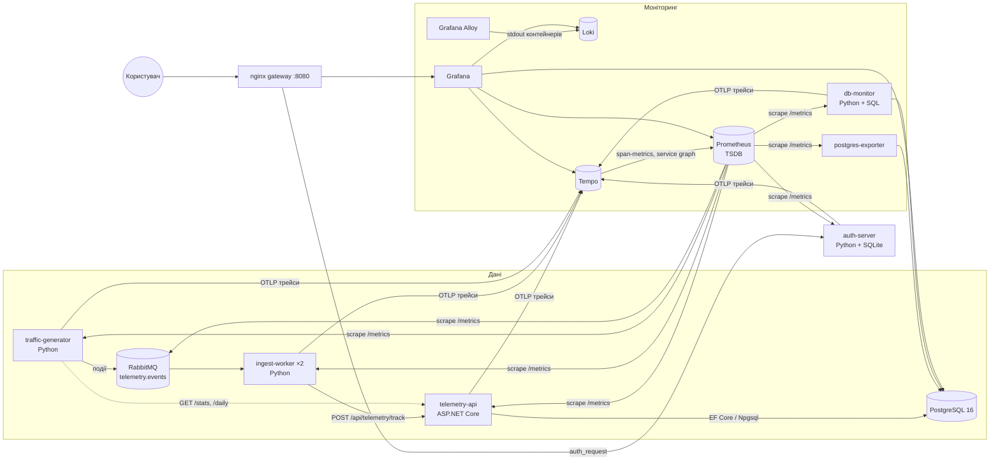

# Система моніторингу роботи БД для AnalyticsSystem

Прикладна інформаційна система, яка отримує дані про роботу з базою даних, збирає метрики через **Prometheus**,
логи через **Grafana Loki**, трейси через **Grafana Tempo** і відображає все це у **Grafana**.
Доступ до системи мають лише авторизовані користувачі (власний **сервер авторизації на Python + SQLite**).

За основу взято курсовий проєкт **AnalyticsSystem** (ASP.NET Core API + PostgreSQL), який збирає телеметрію
відвідувачів сайтів (перегляди сторінок, кліки, воронки).

## Архітектура



## Відповідність пунктам завдання

| № | Вимога | Реалізація |
|---|---|---|
| 0 | СУБД у Docker | `postgres:16-alpine` з увімкненими `pg_stat_statements`, `track_io_timing`, логуванням повільних запитів (>200 мс) |
| 1 | Генерація / актуалізація даних (Python) | `services/workers/generator.py` імітує відвідувачів інтернет-магазину (сесії, переходи по воронці «Каталог → Кошик → Оформлення → Оплата»), інтенсивність змінюється хвилею з випадковими сплесками. Дані потрапляють у БД через API курсової. Окремий потік імітує аналітика, який читає статистику (SELECT-навантаження) |
| 2 | Збір даних — Prometheus | Збирає метрики 12 цілей: `postgres-exporter`, `db-monitor`, API, воркери, RabbitMQ, auth-server, сам стек моніторингу. Правила алертів лежать у `infra/prometheus/alerts.yml` |
| 3 | Time Series Storage | Вбудована TSDB Prometheus у volume `prom-data`, дані зберігаються 15 днів |
| 4 | Відображення — Grafana | 4 дашборди створюються автоматично (provisioning): **Огляд системи**, **PostgreSQL — робота СУБД**, **Аналітика сайту (дані з БД)**, **Логи і трейси** |
| 5 | Логи — Grafana Loki | Grafana Alloy збирає stdout усіх контейнерів. Сервіси пишуть JSON-логи з `trace_id`, рівень логу стає лейблом. Із рядка логу можна одним кліком перейти до трейсу |
| 6 | Трейси — Grafana Tempo | OpenTelemetry у C# (ASP.NET, HttpClient, SQL-запити Npgsql) і в Python. Контекст передається через заголовки RabbitMQ, тому один трейс проходить шлях **generator → RabbitMQ → worker → API → PostgreSQL**. Tempo будує з трейсів граф сервісів і RED-метрики |
| 7 | Авторизація (Python + SQLite) | `services/auth-server`: FastAPI, SQLite (`users`, `sessions`, `login_events`), паролі хешуються через PBKDF2-SHA256, сесія зберігається в JWT-cookie з можливістю відкликання. Після 5 невдалих спроб за 5 хв вхід блокується. Ролі `admin`/`editor`/`viewer` передаються в Grafana. Є сторінка керування користувачами `/auth/users` |
| 8 | Контейнеризація Docker | Увесь стек піднімається однією командою `docker compose up`. Назовні відкритий лише nginx |
| 9 | Брокер повідомлень | RabbitMQ: durable-черга `telemetry.events`, повтори при помилках і dead-letter черга `telemetry.events.dead`. Consumer працює у двох репліках |
| + | «Програмні методи моніторингу СУБД» | `services/workers/db_monitor.py` виконує SQL-запити до `pg_stat_activity`, `pg_stat_user_tables`, `pg_stat_statements`, `pg_locks` і віддає метрики: топ повільних запитів, розміри таблиць, мертві рядки, блокування, найдовший запит |

## Запуск

Потрібен Docker Desktop (або Docker Engine + Compose v2).

```bash
cp .env.example .env          # за потреби змініть паролі
docker compose up -d --build  # перший запуск триває 3–5 хв (збірка .NET і Python образів)
```

Відкрийте **http://localhost:8080** → сторінка входу → `admin` / `admin12345`.

| Адреса | Що там | Доступ |
|---|---|---|
| `/` | Grafana | будь-який користувач |
| `/auth/users` | керування користувачами, журнал входів | admin |
| `/prometheus/` | Prometheus UI (Targets, Alerts, Graph) | admin |
| `/rabbitmq/` | RabbitMQ Management (логін `telemetry`/`telemetry`) | admin |
| `/swagger` | Swagger API курсової | відкрито |
| `/auth/logout` | вихід | — |

Зупинка: `docker compose down`. Щоб видалити ще й усі дані: `docker compose down -v`.

## Що показати на захисті

1. **Авторизація.** Відкрийте `localhost:8080`: система перенаправить на логін. Введіть неправильний пароль кілька разів,
   і в дашборді «Огляд системи» з'явиться графік невдалих входів, а в Prometheus спрацює алерт `BruteForceSuspected`.
   Створіть користувача з роллю `viewer` і покажіть, що він бачить дашборди, але `/prometheus/` для нього закритий.
2. **Огляд системи.** На графіку «Пропускна здатність конвеєра» видно три лінії:
   опубліковано → оброблено → записано в БД.
3. **PostgreSQL.** Тут TPS, cache hit ratio, операції з рядками, розмір таблиць, мертві рядки
   і **топ-10 запитів з `pg_stat_statements`**, серед яких видно INSERT від EF Core.
4. **Аналітика сайту.** Тут топ кнопок, топ сторінок і воронка покупки. Частина панелей отримує дані
   **SQL-запитом напряму з PostgreSQL** (користувач `grafana_ro` має право лише на читання).
5. **Логи і трейси.** Відфільтруйте логи сервісу, розгорніть рядок і натисніть **TraceID**, щоб відкрити трейс у Tempo
   зі спанами `generator.session → rabbitmq.consume → POST /api/telemetry/track → telemetry.write → INSERT`.
   Також тут є граф сервісів (Node graph).
6. **Відмовостійкість.** Виконайте `docker compose stop telemetry-api`. Черга в RabbitMQ почне рости,
   спрацює алерт `QueueBacklog` / `ServiceDown`. Потім виконайте `docker compose start telemetry-api`:
   накопичені повідомлення обробляться, і графік черги впаде до нуля.

## Структура

```
docker-compose.yml           — увесь стек
TelemetrySystem.Api/         — курсова (ASP.NET Core) + Dockerfile, /metrics, OpenTelemetry, JSON-логи
  Observability/AppMetrics.cs  — власні метрики (події, помилки запису, тривалість INSERT, черга)
services/
  common/obs.py              — спільне налаштування логів (JSON + trace_id) і трейсів для Python
  workers/generator.py       — генератор даних -> RabbitMQ
  workers/consumer.py        — RabbitMQ -> API (повтори, DLQ)
  workers/db_monitor.py      — програмний моніторинг PostgreSQL
  auth-server/app.py         — сервер авторизації (FastAPI + SQLite)
infra/
  nginx/        — gateway + auth_request
  prometheus/   — scrape-конфіг, алерти
  loki/ tempo/ alloy/        — логи й трейси
  grafana/      — datasources і дашборди (provisioning)
  postgres/     — init-скрипт (pg_stat_statements, read-only користувач)
  rabbitmq/     — плагіни Prometheus і management, path_prefix
```

## Метрики, додані в проєкт

| Метрика | Джерело | Опис |
|---|---|---|
| `telemetry_events_received_total{event_type}` | API | прийняті події |
| `telemetry_events_written_total`, `telemetry_events_write_errors_total` | API | записи в БД і помилки |
| `telemetry_db_write_duration_seconds` | API | гістограма тривалості INSERT |
| `telemetry_channel_backlog` | API | внутрішня черга перед записом |
| `http_request_duration_seconds` | API | латентність HTTP (prometheus-net) |
| `generator_events_published_total`, `generator_sessions_total{device}` | generator | згенероване навантаження |
| `consumer_messages_processed_total{result}`, `consumer_end_to_end_seconds` | worker | обробка черги, затримка від публікації до запису |
| `app_events_total`, `app_events_last_minute`, `app_top_*` | db-monitor | бізнес-дані з таблиць |
| `db_top_query_mean_ms`, `db_table_*`, `db_connections`, `db_locks_waiting` | db-monitor | стан СУБД |
| `pg_stat_database_*`, `pg_database_size_bytes` | postgres-exporter | стандартні метрики PostgreSQL |
| `auth_logins_total{result}`, `auth_active_sessions` | auth-server | безпека |
| `traces_spanmetrics_*`, `traces_service_graph_*` | Tempo | RED-метрики з трейсів |
