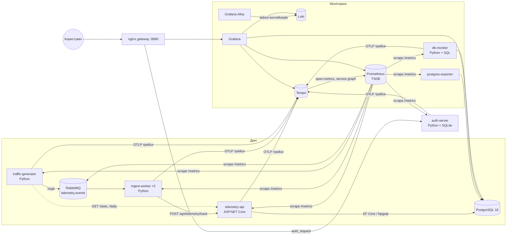

# Система моніторингу роботи БД — детальний опис

Як запустити систему, описано в [README.md](../README.md). Тут описано, що зроблено, як це влаштовано і як перевірено.

## Зміст

1. [Завдання](#1-завдання)
2. [Чому за основу взято AnalyticsSystem](#2-чому-за-основу-взято-analyticssystem)
3. [Архітектура](#3-архітектура)
4. [Відповідність пунктам завдання](#4-відповідність-пунктам-завдання)
5. [Як рухаються дані](#5-як-рухаються-дані)
6. [Авторизація](#6-авторизація)
7. [Метрики](#7-метрики)
8. [Алерти](#8-алерти)
9. [Дашборди Grafana](#9-дашборди-grafana)
10. [Логи і трейси](#10-логи-і-трейси)
11. [Що змінено в курсовому проєкті](#11-що-змінено-в-курсовому-проєкті)
12. [Рев'ю коду й архітектури: що виправлено](#12-рев'ю-коду-й-архітектури-що-виправлено)
13. [Як перевірено](#13-як-перевірено)
14. [Обмеження та примітки](#14-обмеження-та-примітки)

---

## 1. Завдання

Система має отримувати дані про роботу з базою даних, збирати й обробляти метрики через Prometheus і показувати їх у Grafana. Доступ — лише для авторизованих користувачів.

Пункти завдання:

0. СУБД у Docker-контейнері.
1. Генерація та актуалізація даних у БД програмними засобами (Python).
2. Збір даних — Prometheus.
3. Збереження — Time Series Storage (вбудована БД Prometheus).
4. Відображення — Grafana.
5. Логи — Grafana Loki.
6. Трейси — Grafana Tempo.
7. Авторизація — сервер авторизації (Python + SQLite).
8. Контейнеризація — Docker.
9. Обмін повідомленнями між сервісами — RabbitMQ / Kafka (необов'язково).

Усі 10 пунктів реалізовано, включно з необов'язковим брокером повідомлень. Додатково зроблено програмний моніторинг СУБД власним Python-сервісом.

## 2. Чому за основу взято AnalyticsSystem

**AnalyticsSystem** — курсовий проєкт: сервіс веб-аналітики на ASP.NET Core 10 + PostgreSQL + EF Core. Сайти підключають скрипт `tracker.js`, який відправляє в API події відвідувачів (перегляди сторінок, кліки). API записує їх у PostgreSQL і рахує статистику: топ кнопок, топ сторінок, воронки.

Для цієї лабораторної це добра основа, бо:

- **Завдання — моніторити роботу з БД, тож потрібен застосунок, який справді працює з БД.** AnalyticsSystem постійно пише в PostgreSQL (INSERT кожної події) і читає з неї (агрегаційні SELECT для статистики). Тому на дашбордах видно реальне навантаження: TPS, операції з рядками, кеш, топ запитів з `pg_stat_statements`.
- **Є що показати на кожному рівні.** HTTP-запити до API, черга перед записом у БД, SQL-запити EF Core, бізнес-дані з таблиць. Метрики, логи і трейси пов'язані між собою, а не синтетичні.
- **Курсову майже не довелося змінювати.** Додано лише «спостережуваність»: метрики, трейси, JSON-логи (див. розділ 11). Бізнес-логіка, моделі й міграції не змінені. Unit-тести курсової проходять (5 з 5).
- **Вимогу «генерація даних на Python» виконано.** Python-генератор імітує відвідувачів інтернет-магазину, а Python-сервіс `db-monitor` сам підключається до PostgreSQL і читає системні представлення.

Альтернатива — простий Python-скрипт, що вставляє випадкові рядки в таблицю. Він виконав би пункт 1 формально, але дав би бідніші дані для моніторингу й трейсингу. Тому для цієї роботи AnalyticsSystem підходить краще.

Фронтенд курсової (`telemetry-dashboard`, Angular) лежить у репозиторії, але в стеку не запускається: для лабораторної він не потрібен, а дані показує Grafana.

## 3. Архітектура



Контейнери (усього 15):

| Контейнер | Образ / мова | Роль |
|---|---|---|
| `postgres` | `postgres:16-alpine` | СУБД; увімкнено `pg_stat_statements`, `track_io_timing`, лог запитів довших за 200 мс |
| `telemetry-api` | ASP.NET Core 10 | курсова AnalyticsSystem: прийом подій, запис у БД, статистика |
| `rabbitmq` | `rabbitmq:3.13-management` | брокер повідомлень, плагіни management і prometheus |
| `traffic-generator` | Python 3.12 | генерує відвідувачів сайту → RabbitMQ; імітує аналітика (GET-запити) |
| `ingest-worker` ×2 | Python 3.12 | читає чергу → POST в API; повтори та DLQ |
| `db-monitor` | Python 3.12 + psycopg2 | програмний моніторинг PostgreSQL через SQL |
| `postgres-exporter` | `postgres-exporter:v0.15.0` | стандартні метрики PostgreSQL |
| `prometheus` | `prometheus:v2.54.1` | збір метрик, TSDB, алерти |
| `loki` | `loki:3.2.1` | зберігання логів |
| `alloy` | `alloy:v1.4.3` | збирає stdout усіх контейнерів → Loki |
| `tempo` | `tempo:2.6.1` | зберігання трейсів; генерує з них метрики → Prometheus |
| `grafana` | `grafana:11.3.0` | дашборди |
| `auth-server` | Python 3.12 + FastAPI + SQLite | сервер авторизації |
| `gateway` | `nginx:1.27-alpine` | єдина точка входу (порт 8080), перевірка доступу |

Усі контейнери мають `restart: unless-stopped`, тому після перезапуску Docker або збою стек піднімається сам. Python-воркери й API працюють від непривілейованого користувача, а при `docker compose stop` завершуються коректно: воркери за ~1 с, API спершу дописує в БД події з внутрішньої черги.

Назовні відкритий **лише nginx** (порт 8080). PostgreSQL, Prometheus, Grafana та інші сервіси доступні тільки всередині Docker-мережі або через nginx після входу.

## 4. Відповідність пунктам завдання

| № | Вимога | Як реалізовано | Де в коді |
|---|---|---|---|
| 0 | СУБД у Docker | PostgreSQL 16 у контейнері з healthcheck; при першому запуску init-скрипт вмикає `pg_stat_statements` і створює користувача `grafana_ro` лише для читання | `docker-compose.yml` (сервіс `postgres`), `infra/postgres/init.sh` |
| 1 | Генерація / актуалізація даних (Python) | Генератор імітує відвідувачів інтернет-магазину: сесії, переходи «Каталог → Кошик → Оформлення → Оплата», різні пристрої. Інтенсивність змінюється хвилею з періодом 5 хв і рідкісними сплесками. Дані потрапляють у БД через RabbitMQ та API курсової. Окремий потік імітує аналітика, який читає статистику (SELECT-навантаження) | `services/workers/generator.py`, `services/workers/consumer.py` |
| 2 | Збір даних — Prometheus | Prometheus кожні 10 с збирає метрики з 13 цілей (див. розділ 7) і перевіряє правила алертів | `infra/prometheus/prometheus.yml`, `infra/prometheus/alerts.yml` |
| 3 | Time Series Storage | Вбудована TSDB Prometheus у Docker-volume `prom-data`, зберігання 15 днів (`--storage.tsdb.retention.time=15d`) | `docker-compose.yml` (сервіс `prometheus`) |
| 4 | Відображення — Grafana | 4 дашборди і 4 джерела даних створюються автоматично при старті (provisioning) | `infra/grafana/` |
| 5 | Логи — Grafana Loki | Alloy збирає stdout усіх контейнерів; сервіси пишуть JSON-логи з `trace_id`; рівень логу стає лейблом; з рядка логу можна перейти до трейсу. Логи зберігаються 7 днів | `infra/alloy/config.alloy`, `infra/loki/loki.yml`, `services/common/obs.py` |
| 6 | Трейси — Grafana Tempo | OpenTelemetry у C# і Python; контекст трейсу передається через HTTP-заголовки і заголовки повідомлень RabbitMQ, тому одна подія — один наскрізний трейс. Tempo будує з трейсів граф сервісів і RED-метрики | `TelemetrySystem.Api/Program.cs`, `services/common/obs.py`, `infra/tempo/tempo.yml` |
| 7 | Авторизація (Python + SQLite) | Власний сервер на FastAPI з базою SQLite; nginx перевіряє кожен запит через нього (розділ 6) | `services/auth-server/app.py`, `infra/nginx/nginx.conf` |
| 8 | Контейнеризація Docker | Увесь стек описаний у `docker-compose.yml` і піднімається однією командою; власні образи мають Dockerfile | `docker-compose.yml`, `*/Dockerfile` |
| 9 | Брокер повідомлень | RabbitMQ: durable-черга `telemetry.events`, підтвердження обробки (ack), повтори при помилках, dead-letter черга `telemetry.events.dead`; consumer працює у двох екземплярах | `services/workers/consumer.py` |
| + | Програмний моніторинг СУБД | `db-monitor` кожні 15 с виконує SQL-запити до `pg_stat_activity`, `pg_stat_user_tables`, `pg_stat_statements`, `pg_locks` і до таблиць курсової та віддає результати як метрики Prometheus | `services/workers/db_monitor.py` |

## 5. Як рухаються дані

1. **`traffic-generator`** створює сесію відвідувача (від 1 до 8 кроків). На кожному кроці він публікує в RabbitMQ події `page_view` і `click`. Разом з подією в заголовках повідомлення передається контекст трейсу (`traceparent`) і час відправки.
2. **RabbitMQ** зберігає повідомлення в durable-черзі `telemetry.events`, тож вони не губляться при перезапуску.
3. **`ingest-worker`** (2 екземпляри) забирає повідомлення і відправляє `POST /api/telemetry/track` в API.
   - Якщо API недоступний або відповів 5xx, повідомлення повертається в чергу з лічильником спроб (до 3), заголовки трейсу зберігаються.
   - Якщо API відхилив подію (4xx), повтор не допоможе: повідомлення одразу йде в `telemetry.events.dead`.
   - Після 3 невдалих спроб, а також якщо повідомлення не є JSON-об'єктом, воно теж іде в DLQ. У заголовку `x-error` записується причина.
   - Будь-яка неочікувана помилка не зупиняє воркер: повідомлення йде в DLQ, обробка триває.
   - Поки API недоступний, воркер нічого не втрачає: черга просто накопичується.
4. **`telemetry-api`** приймає подію і кладе її у внутрішню чергу (`Channel`), а фоновий сервіс записує її в PostgreSQL через EF Core. Якщо черга переповнена, подія відкидається і рахується в метриці `telemetry_events_dropped_total` (алерт `EventsDropped`).
5. **Паралельно** генератор раз на 2–6 с робить «аналітичні» GET-запити (`/stats`, `/clicks`, `/daily`, `/url-stats`, `/custom-funnels`). Це SELECT-навантаження на БД.
6. **`db-monitor`** і **`postgres-exporter`** читають стан PostgreSQL. **Prometheus** збирає всі метрики, **Alloy** — логи, **Tempo** — трейси, а **Grafana** показує все разом.

## 6. Авторизація

Схема — **nginx `auth_request` + власний сервер авторизації**:

1. Будь-який запит до Grafana, Prometheus чи RabbitMQ UI спочатку потрапляє в nginx.
2. nginx робить внутрішній підзапит `GET /auth/verify` до `auth-server` разом із cookie користувача.
3. `auth-server` перевіряє JWT у cookie і сесію в SQLite:
   - сесія валідна → відповідь `200` із заголовками `X-User` і `X-Role`;
   - сесії немає → `401`, і nginx перенаправляє на `/auth/start-login`. Той бере початкову адресу із заголовка `X-Original-URI`, перевіряє її і кодує в параметр `next` сторінки `/auth/login`. Після входу користувач повертається туди ж, разом із параметрами запиту;
   - для `/prometheus/` і `/rabbitmq/` додатково потрібна роль `admin`, інакше `403` і сторінка «Доступ заборонено».
4. nginx передає ім'я і роль у Grafana заголовками `X-WEBAUTH-USER` / `X-WEBAUTH-ROLE`. Grafana працює в режимі **auth proxy**: власна форма входу вимкнена, користувач створюється автоматично з потрібною роллю (Admin / Editor / Viewer).

**Захист від підробки:** nginx завжди перезаписує заголовки `X-WEBAUTH-*` значеннями від `auth-server`. Grafana назовні недоступна, тож обійти nginx неможливо. Запит з підробленим `X-WEBAUTH-USER: admin` без cookie отримує редірект на сторінку входу (перевірено).

**Що зберігається в SQLite** (`/data/auth.db`, volume `auth-data`):

| Таблиця | Вміст |
|---|---|
| `users` | логін, хеш пароля (PBKDF2-SHA256 з сіллю), роль `admin` / `editor` / `viewer` |
| `sessions` | видані сесії, термін дії (8 год), ознака відкликання |
| `login_events` | журнал усіх спроб входу (логін, IP, успіх, час) |

**Безпека:**
- Cookie `obs_session` має прапорці `HttpOnly` і `SameSite=Lax`.
- Ключ підпису JWT (`AUTH_SECRET`) не зашитий у код. Якщо змінна порожня, сервер генерує випадковий ключ і зберігає його у файлі `/data/auth_secret` з правами 0600.
- При виході (`/auth/logout`) сесія відкликається в БД, тож старий токен більше не працює.
- Після 5 невдалих спроб входу за 5 хвилин пара «логін + IP» блокується (HTTP 429). Блокування саме за парою не дає зловмиснику заблокувати адміністратора з іншої адреси. У Prometheus з'являється метрика й алерт `BruteForceSuspected`.
- Час перевірки пароля однаковий для існуючого й неіснуючого логіна (перевірка з фіктивним хешем), тому за часом відповіді не можна дізнатися, чи є такий користувач.
- Параметр `next` після входу приймає лише локальні шляхи. Відкидаються `//host`, `/\host`, зворотні слеші й керувальні символи, тож відкритий редірект і CRLF-ін'єкція неможливі.
- Форми створення й видалення користувачів захищені від CSRF: заголовок `Origin` (або `Referer`) має збігатися з адресою сайту, інакше `403`.
- Логін нового користувача може містити лише `A-Z a-z 0-9 . _ -` (до 64 символів).
- Прострочені сесії і записи журналу входів, старші за 30 днів, видаляються автоматично.

На сторінці `/auth/users` адміністратор створює й видаляє користувачів і бачить журнал останніх входів.

Перший адміністратор створюється при першому запуску з `ADMIN_USERNAME` / `ADMIN_PASSWORD` з `.env`.

## 7. Метрики

**Цілі Prometheus (13):** `prometheus`, `postgres-exporter`, `db-monitor`, `telemetry-api`, `traffic-generator`, `ingest-worker` (2 екземпляри через DNS-discovery), `auth-server`, `rabbitmq`, `loki`, `tempo`, `alloy`, `grafana`.

Власні метрики, додані в проєкт:

| Метрика | Джерело | Опис |
|---|---|---|
| `telemetry_events_received_total{event_type}` | API | прийняті події; невідомі типи потрапляють у `event_type="other"`, щоб довільні рядки від клієнтів не створювали нескінченно нових часових рядів |
| `telemetry_events_written_total`, `telemetry_events_write_errors_total` | API | записи в БД і помилки запису |
| `telemetry_db_write_duration_seconds` | API | гістограма тривалості INSERT |
| `telemetry_channel_backlog` | API | розмір внутрішньої черги перед записом (читається в момент збору метрик) |
| `telemetry_events_dropped_total` | API | події, відкинуті через переповнену внутрішню чергу |
| `http_request_duration_seconds`, `http_requests_received_total` | API (prometheus-net) | латентність і кількість HTTP-запитів |
| `generator_events_published_total`, `generator_sessions_total{device}` | generator | згенероване навантаження |
| `generator_target_sessions_per_second` | generator | поточна цільова інтенсивність |
| `consumer_messages_processed_total{result}` | worker | оброблено / повтор / DLQ / пошкоджене |
| `consumer_end_to_end_seconds` | worker | затримка від публікації до запису через API |
| `app_events_total`, `app_events_last_minute`, `app_active_sessions_5m`, `app_top_*` | db-monitor | бізнес-дані з таблиць курсової |
| `db_top_query_mean_ms`, `db_top_query_calls` | db-monitor | топ запитів з `pg_stat_statements`; лише SELECT / INSERT / UPDATE / DELETE / WITH, щоб службові команди (наприклад, `CREATE ROLE ... PASSWORD`) не потрапили в лейбли метрик |
| `db_table_size_bytes`, `db_table_live_rows`, `db_table_dead_rows`, `db_table_seq_scans`, `db_table_idx_scans` | db-monitor | стан таблиць |
| `db_connections{state}`, `db_longest_running_query_seconds`, `db_locks_waiting` | db-monitor | з'єднання, довгі запити, блокування |
| `pg_stat_database_*`, `pg_database_size_bytes`, `pg_up` | postgres-exporter | стандартні метрики PostgreSQL |

**Доступ до БД з мінімальними правами.** Grafana, `db-monitor` і `postgres-exporter` підключаються до PostgreSQL як `grafana_ro`, а не як суперкористувач. Ця роль має:
- `SELECT` на таблиці курсової і роль `pg_monitor` для системних представлень;
- для таблиці `Companies` лише стовпці `Id`, `AppId`, `Name`. Хеші паролів компаній вона не бачить;
- жодних прав на зміну даних.

Курсова застосовує міграції EF Core при старті і може перестворювати таблиці. Тому в `infra/postgres/init.sh` є *event trigger*: після кожного `CREATE TABLE` / `ALTER TABLE` він знову обмежує доступ до `Companies`. Скрипт ідемпотентний, його можна безпечно запускати повторно.
| `rabbitmq_queue_messages_ready` тощо | RabbitMQ | стан черг |
| `auth_logins_total{result}`, `auth_active_sessions`, `auth_users_total` | auth-server | безпека |
| `traces_spanmetrics_*`, `traces_service_graph_*` | Tempo | RED-метрики і зв'язки сервісів, обчислені з трейсів |

## 8. Алерти

Правила лежать в `infra/prometheus/alerts.yml`. Їх видно в Prometheus на вкладці *Alerts* (`/prometheus/alerts`).

| Алерт | Умова | Рівень |
|---|---|---|
| `PostgresDown` | `pg_up == 0` протягом 30 с | critical |
| `TooManyConnections` | більше 80 з'єднань протягом 1 хв | warning |
| `LowCacheHitRatio` | cache hit ratio нижче 90% протягом 5 хв **і** читається понад 10 блоків/с (без цієї умови алерт спрацьовував на майже порожній БД) | warning |
| `LongRunningQuery` | запит виконується довше 30 с | warning |
| `DbWriteErrors` | є помилки запису подій за 5 хв | warning |
| `QueueBacklog` | у черзі більше 1000 повідомлень протягом 2 хв | warning |
| `DeadLetters` | у DLQ є повідомлення | warning |
| `NoEventsWritten` | нові події не записуються 2 хв (спрацьовує і тоді, коли метрики API зовсім немає) | critical |
| `EventsDropped` | API відкидає події через переповнену внутрішню чергу | warning |
| `IngestWorkerReplicasMissing` | працює менше 2 екземплярів `ingest-worker` | warning |
| `ServiceDown` | будь-яка ціль недоступна 1 хв | critical |
| `BruteForceSuspected` | більше 10 невдалих / заблокованих входів за 5 хв | warning |

Усього 12 правил; синтаксис перевірено `promtool check rules`. Alertmanager не підключено, тож алерти видно в Prometheus і Grafana, але сповіщення нікуди не надсилаються.

## 9. Дашборди Grafana

Дашборди створюються автоматично з файлів `infra/grafana/dashboards/*.json` і лежать у папці «Моніторинг БД». Оновлення — кожні 10 с.

**Огляд системи** (`db-overview`)
- Стан: PostgreSQL UP/DOWN, кількість сервісів UP/DOWN, подій у БД, швидкість запису, активні сесії.
- Потік даних: пропускна здатність конвеєра (опубліковано → оброблено → записано), черги RabbitMQ, затримка API (p50/p95/p99), запити до API за кодом відповіді, результати обробки в consumer.
- Безпека та логи: входи в систему моніторингу, обсяг логів за сервісами, останні помилки й попередження.

**PostgreSQL — робота СУБД** (`db-postgres`)
- Загальне: розмір БД, з'єднання, TPS, cache hit ratio, найдовший запит, очікування блокувань.
- Навантаження: транзакції за секунду, операції з рядками (insert/update/delete/fetch), з'єднання за станом, блоки з кешу й з диска, тривалість INSERT з API, deadlocks / конфлікти / temp-файли.
- Таблиці: розміри таблиць, живі й мертві рядки, послідовні та індексні сканування, топ-10 запитів за сумарним часом з `pg_stat_statements`.

**Аналітика сайту (дані з БД)** (`db-analytics`)
- Події за хвилину, сесії за 5 хв, кількість компаній, цільова інтенсивність генератора.
- Події за типом, сесії за пристроями, топ кнопок і топ сторінок за 10 хв.
- **SQL напряму з PostgreSQL** (джерело даних `PostgreSQL`, користувач `grafana_ro` лише з правом читання): події за хвилину, останні 50 подій, воронка покупки за обраний період.

**Логи (Loki) і трейси (Tempo)** (`db-logs-traces`)
- Фільтри: сервіс, рівень логу, пошук у тексті.
- Кількість рядків логу за рівнем, помилки за сервісами, потік логів.
- Граф сервісів, RED-метрики зі span-metrics, p95 тривалості спанів.
- Останні трейси (TraceQL) і повільні або помилкові трейси (> 200 мс або error).

## 10. Логи і трейси

**Логи.** Усі сервіси пишуть логи в stdout у форматі JSON:
- Python-сервіси — через `services/common/obs.py`: `ts`, `level`, `service`, `msg`, `trace_id`, `span_id` і додаткові поля;
- API — через `AddJsonConsole`; `TraceId` потрапляє в рядок через scopes.

Grafana Alloy через Docker API забирає stdout контейнерів цього compose-проєкту, виставляє лейбли `service`, `container`, `level` і відправляє в Loki.

Сервіси пишуть рівень по-різному: Python — `info`, ASP.NET Core — `Information`, PostgreSQL — `ERROR:` у тексті, Loki і Tempo — `level=warn`. Alloy зводить усе до чотирьох значень: `error`, `warning`, `info`, `debug`. Тому фільтр за рівнем на дашборді працює однаково для всіх сервісів. У джерелі даних Loki налаштовано *derived field*: регулярний вираз знаходить `trace_id` / `TraceId` у рядку, і біля нього з'являється посилання «Відкрити трейс» у Tempo.

Генератор на кожну сесію пише рядок `Session published` з `trace_id`. З нього найзручніше показувати перехід «лог → трейс».

**Трейси.** OpenTelemetry SDK у кожному сервісі експортує спани по OTLP/HTTP у Tempo. Трейс однієї сесії відвідувача виглядає так:

```
traffic-generator   generator.session
traffic-generator     telemetry.events publish  (PRODUCER-спан публікації в RabbitMQ)
ingest-worker           rabbitmq.consume        (контекст з заголовків повідомлення RabbitMQ)
ingest-worker             POST                  (HTTP-клієнт requests)
telemetry-api               POST api/Telemetry/track
telemetry-api                 telemetry.write     (фоновий запис у БД)
telemetry-api                   postgresql        (SQL INSERT від драйвера Npgsql)
```

Аналітичні GET-запити генератора дають трейси `analyst.get_*` → `GET api/Telemetry/...` → SQL SELECT. `db-monitor` створює трейс `db_monitor.collect` на кожен збір.

Tempo (metrics-generator) з трейсів будує:
- **span-metrics** — кількість і тривалість викликів за сервісами;
- **service graph** — зв'язки між сервісами. Ребро `traffic-generator → ingest-worker` з'являється завдяки парі спанів PRODUCER (публікація) і CONSUMER (обробка).

Обидва набори метрик Tempo відправляє в Prometheus (remote write), і їх показує дашборд «Логи і трейси».

## 11. Що змінено в курсовому проєкті

Порівняння з репозиторієм курсової (`github.com/Roshira/AnalyticsSystem`). Моделі, міграції, контролер авторизації, сервіс аналітики, тести й фронтенд не змінені.

| Файл | Зміна |
|---|---|
| `TelemetrySystem.Api.csproj` | пакети `prometheus-net.AspNetCore` і OpenTelemetry 1.20.1; Swashbuckle оновлено до 10.3.1 (прибирає попередження NU1903 про вразливість `Microsoft.OpenApi`); зайвий `Microsoft.AspNetCore.OpenApi` прибрано; явна версія `Microsoft.EntityFrameworkCore.Relational` прибирає конфлікт версій MSB3277 |
| `Program.cs` | JSON-логи в stdout; OpenTelemetry-трейсинг (ASP.NET Core, HttpClient, Npgsql) з експортом у Tempo; `UseHttpMetrics()` і `/metrics`; `/health`; повтор міграції БД лише при мережевих помилках, поки PostgreSQL стартує; лічильник відкинутих подій для обмеженого `Channel`; Swagger вмикається і в Production прапорцем `EnableSwagger` |
| `Observability/AppMetrics.cs` (новий) | власні метрики, білий список типів подій для лейблів, `ActivitySource` |
| `Observability/EventTraceContext.cs` (новий) | передає контекст трейсу з HTTP-запиту у фоновий запис через `Channel`, щоб INSERT був частиною наскрізного трейсу |
| `Controllers/TelemetryController.cs` | лічильник прийнятих подій, збереження контексту трейсу |
| `BackgroundTasks/TelemetryWriterService.cs` | спан `telemetry.write`, лічильники записів і помилок, гістограма тривалості INSERT (лише успішних); при зупинці дописує в БД події, що залишились у черзі (до 5 с) |
| `Dockerfile`, `.dockerignore` (нові) | збірка образу API, запуск від непривілейованого користувача |

## 12. Рев'ю коду й архітектури: що виправлено

Після першої версії зроблено детальне рев'ю всього коду і конфігурацій. Знайдені проблеми виправлено, на кожну важливу є автоматичний тест.

**Безпека**

| Проблема | Наслідок | Виправлення |
|---|---|---|
| nginx будував редірект на вхід з розкодованого `$uri` | CRLF-ін'єкція: `/x%0d%0aSet-Cookie:...` вставляв заголовок у відповідь | редірект робить `auth-server` (`/auth/start-login`), адреса кодується; заодно зберігаються параметри запиту |
| `safe_next` пропускав `/\evil.example` | відкритий редірект на чужий сайт після входу | відкидаються зворотні слеші й керувальні символи |
| форми `/auth/users` без захисту від CSRF | чужий сайт міг створити адміністратора від імені залогіненого admin | перевірка `Origin` / `Referer`, інакше `403` |
| блокування входу лише за логіном | будь-хто міг заблокувати `admin` неправильними паролями | блокування за парою «логін + IP» |
| різний час відповіді для існуючого й неіснуючого логіна | можна перебором дізнатися логіни | перевірка з фіктивним хешем |
| `AUTH_SECRET` за замовчуванням був відомим рядком | будь-хто міг підробити сесію | порожній за замовчуванням, тоді генерується випадковий ключ |
| `db-monitor` і `postgres-exporter` підключались як суперкористувач `postgres` | компрометація моніторингу давала повний доступ до БД | роль `grafana_ro` з `pg_monitor` і лише читанням |
| `grafana_ro` читав `Companies.PasswordHash` | хеші паролів компаній видно в Grafana | доступ лише до стовпців `Id`, `AppId`, `Name`; event trigger тримає це обмеження після міграцій |
| у топ-запитах `pg_stat_statements` був `CREATE ROLE ... PASSWORD '...'` | пароль потрапляв у лейбли метрик Prometheus | у метрики потрапляють лише DML-запити; `track_utility=off` |
| вбудований адміністратор Grafana мав пароль за замовчуванням і був увімкнений Basic Auth | обхід сервера авторизації через API Grafana зсередини мережі | `GF_AUTH_BASIC_ENABLED=false`, пароль з `.env` |
| API працював у режимі Development | у відповідях на помилки видно стектрейси | режим Production; Swagger вмикається окремим прапорцем |
| nginx маршрутизував `/api/...` з урахуванням регістру | запити Swagger на `/api/Auth/login` потрапляли в Grafana | регістронезалежні `location` |
| контейнери воркерів і API працювали від root | вища шкода при компрометації | непривілейований користувач |

**Надійність**

| Проблема | Виправлення |
|---|---|
| повідомлення, яке не є JSON-об'єктом (`[]`, `"x"`), або неочікувана помилка зупиняли воркер | такі повідомлення йдуть у DLQ, обробка триває |
| відповідь API 4xx повторювалась 3 рази | 4xx одразу йде в DLQ з причиною |
| при повторі губились заголовки (трейс, час відправки) | заголовки зберігаються |
| некоректний `x-sent-at` відправляв уже записану подію в DLQ | значення ігнорується |
| при помилці публікації генератор втрачав подію і не закривав старе з'єднання | повторна публікація після перепідключення, старе з'єднання закривається |
| при зупинці API події з внутрішньої черги губились, а `SaveChanges` переривався | черга дописується (до 5 с), запис не скасовується |
| переповнення внутрішньої черги API ніде не було видно | метрика `telemetry_events_dropped_total` і алерт |
| Python-сервіси при `docker compose stop` чекали 10 с і вбивались | коректне завершення по SIGTERM за ~1 с |
| `db-monitor` міг зависнути на довгому запиті | `connect_timeout` і `statement_timeout`; будь-яка помилка не зупиняє цикл |
| таблиці, яких уже немає, лишались у метриках `db-monitor` | метрики таблиць очищаються щоциклу |
| сервіси не перезапускались після збою | `restart: unless-stopped` |
| повтор міграції ловив будь-яку помилку (зокрема помилку в самій міграції) | повтор лише при мережевих помилках і таймаутах |
| nginx кешував IP контейнерів при старті; після перезапуску сервісу шлюз віддавав 502 | `resolver 127.0.0.11` і змінні в `proxy_pass` |
| Alloy губив позицію читання логів при перезапуску | окремий volume `alloy-data` |

**Метрики, логи, алерти**

| Проблема | Виправлення |
|---|---|
| `event_type` з запиту клієнта йшов у лейбл метрики напряму | білий список, решта → `other` (захист від вибуху кількості часових рядів) |
| `DbWriteDuration` враховував і невдалі записи | лише успішні |
| рівні логів різнились (`Information`, `info`, `warn`, `ERROR:`), а `stage.logfmt` в Alloy писав помилку на кожен JSON-рядок | нормалізація до `error / warning / info / debug`, regex замість logfmt |
| `LowCacheHitRatio` спрацьовував на майже порожній БД; `NoEventsWritten` не спрацьовував, якщо метрики немає зовсім | умова мінімального навантаження і `or vector(0)` |
| не було алертів на відкинуті події і на падіння одного з двох воркерів | `EventsDropped`, `IngestWorkerReplicasMissing` |
| у графі сервісів не було зв'язку `traffic-generator → ingest-worker` | PRODUCER-спан публікації в RabbitMQ |
| exemplars з метрик не відкривали трейс | друга назва лейбла `traceID` у налаштуваннях джерела даних |
| Loki відхиляв логи при сплесках | збільшено `ingestion_rate_mb` / `ingestion_burst_size_mb` |

**Залежності:** прибрано попередження NuGet NU1903 і MSB3277 (див. розділ 11); `requests` оновлено до 2.32.4, `python-multipart` до 0.0.20 (виправлені вразливості).

## 13. Як перевірено

Перевірено 03.11.2026 на Windows 11 + Docker Desktop 29.1 (Compose v5.0) повним запуском `docker compose up -d --build`.

**Автоматичні тести** (як запустити — README, розділ 5):

| Набір | Що перевіряє | Результат |
|---|---|---|
| `tests/integration_test.py` | увесь стек через шлюз: безпека, Prometheus, конвеєр даних, права БД, логи, трейси, кожна панель кожного дашборду | 86 з 86 |
| `services/auth-server/tests/test_app.py` | `safe_next`, хешування паролів, генерація ключа, вхід / вихід / підробка токена, `start-login`, блокування за IP, CSRF, валідація логіна, права viewer | 13 з 13 |
| `services/workers/tests/test_consumer.py` | обробка повідомлень: успіх, 4xx → DLQ, 5xx → повтор → DLQ, пошкоджений JSON, неочікувана помилка, збереження заголовків | 7 з 7 |
| `TelemetrySystem.Api.Tests` | unit-тести курсової | 5 з 5 |

Також перевірено: `promtool check rules` (12 правил), коректна зупинка всіх сервісів (код виходу 0), запис залишку черги API при зупинці.

**Ручна перевірка:**

| Що перевірялось | Результат |
|---|---|
| Запуск стека | усі 15 контейнерів `Up`, `postgres` і `rabbitmq` — `healthy` |
| Цілі Prometheus | 13 з 13 у стані `up` |
| Потік даних | події записуються в БД зі швидкістю ~20–40 подій/с, черга RabbitMQ не накопичується |
| Без входу | `/` і `/prometheus/` перенаправляють на сторінку входу |
| Підробка заголовка | `X-WEBAUTH-USER: admin` без cookie → редірект на логін |
| Невірний пароль | HTTP 401 |
| Роль admin | Grafana Admin, доступ до `/prometheus/` |
| Роль viewer | Grafana Viewer, `/prometheus/` закритий («Доступ заборонено») |
| Джерела даних Grafana | Prometheus, Loki, PostgreSQL — OK |
| Дашборди | усі 4 показують дані |
| Loki | логи від усіх 14 сервісів, що пишуть у stdout |
| Tempo | наскрізний трейс generator → RabbitMQ → worker → API → `telemetry.write` → SQL; перехід з рядка логу за `trace_id` відкриває цей трейс |
| Метрики з трейсів | `traces_spanmetrics_*` і `traces_service_graph_*` є в Prometheus |
| Зупинка API на ~70 с | черга виросла до ~2000 повідомлень, у DLQ — 0; після запуску API черга спорожніла за ~15 с |
| Unit-тести курсової | 5 з 5 пройдено (`dotnet test`) |

## 14. Обмеження та примітки

- **Паролі в `.env.example` демонстраційні.** Для реального використання їх треба змінити. `AUTH_SECRET` можна лишити порожнім: тоді ключ згенерується сам.
- **Ключ підпису JWT у курсовій** (`Program.cs`, `AuthController.cs`) зашитий у код. Так було в оригінальній курсовій. Для лабораторної це не критично, бо стосується лише входу компаній в API AnalyticsSystem, а не входу в систему моніторингу.
- **Cookie працює без HTTPS** (`COOKIE_SECURE=false`), бо система запускається локально по HTTP. Якщо поставити її за HTTPS, достатньо задати `COOKIE_SECURE=true` для `auth-server`.
- **Swagger API відкритий** без входу. Через `tracker.js` сайти шлють події без авторизації, як і в курсовій. Аналітичні ендпоінти API захищені власним JWT курсової.
- **Кнопка «Test» для Tempo** в Grafana 11 показує «Method not implemented»: перевірка зв'язку для Tempo не реалізована. Самі трейси при цьому працюють.
- **Службові логи ASP.NET Core та EF Core** (кожен HTTP-запит і кожен INSERT) вимкнено до рівня Warning змінними `Logging__LogLevel__*` у `docker-compose.yml`. Інакше вони давали близько 2000 рядків на хвилину й засмічували Loki.
- **Недоліки самої курсової не виправлялись**, щоб не змінювати її бізнес-логіку: паролі компаній хешуються SHA-256 без солі, `/track` не валідує вхідні дані, немає складених індексів під аналітичні запити, у `custom-funnels` є N+1 запитів. Кожна подія пишеться окремим INSERT: так задумано в курсовій, і так видно наскрізний трейс до SQL.
- **Grafana довіряє заголовку `X-WEBAUTH-USER` від будь-кого у внутрішній Docker-мережі.** Назовні Grafana не відкрита, а nginx завжди перезаписує цей заголовок. Для продакшну варто додатково обмежити auth proxy IP-адресою шлюзу (`whitelist`).
- **Alloy має доступ до `docker.sock`**, щоб читати логи контейнерів. Це фактично root-доступ до хоста. Для лабораторної прийнятно; у продакшні логи краще збирати через logging driver або файли.
- **`auth-server` і Tempo працюють від root**, бо їхні volume вже створені з власником root. Для нової інсталяції їх можна перевести на непривілейованого користувача.
- **Видалений у `/auth/users` користувач залишається у списку користувачів Grafana.** Увійти він уже не може: його сесії відкликано, а нову сесію `auth-server` не видасть.
- **Користувач RabbitMQ `telemetry` — адміністратор брокера.** Для лабораторної так простіше; у продакшні варто мати окремих користувачів з мінімальними правами для воркерів і для UI.
